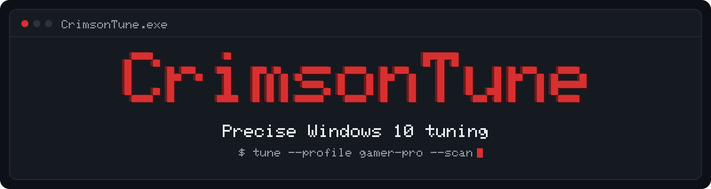
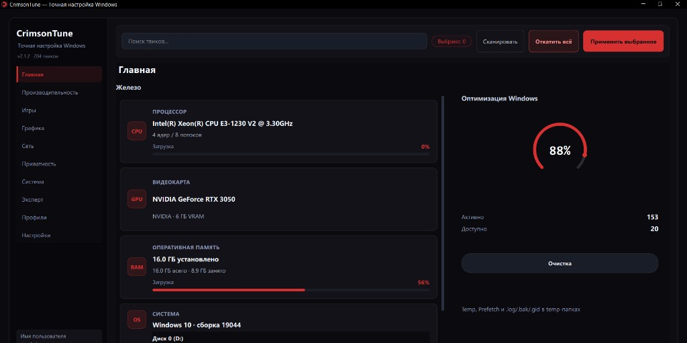
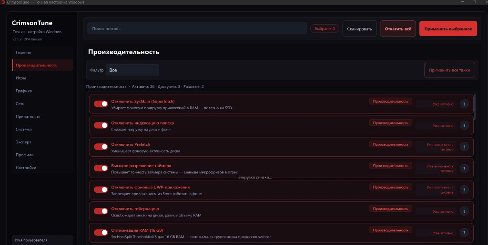
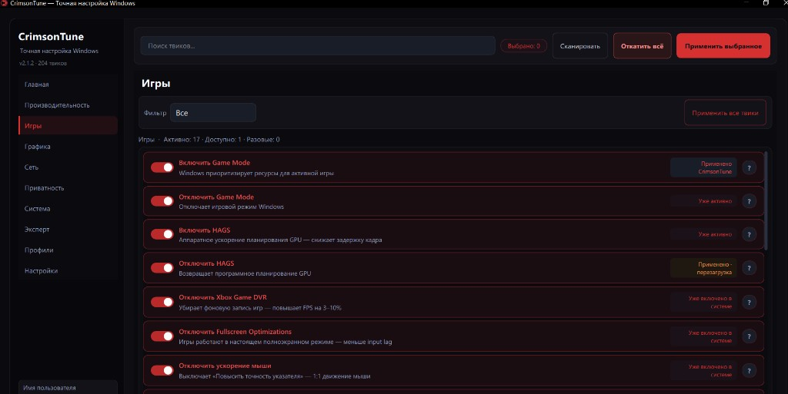
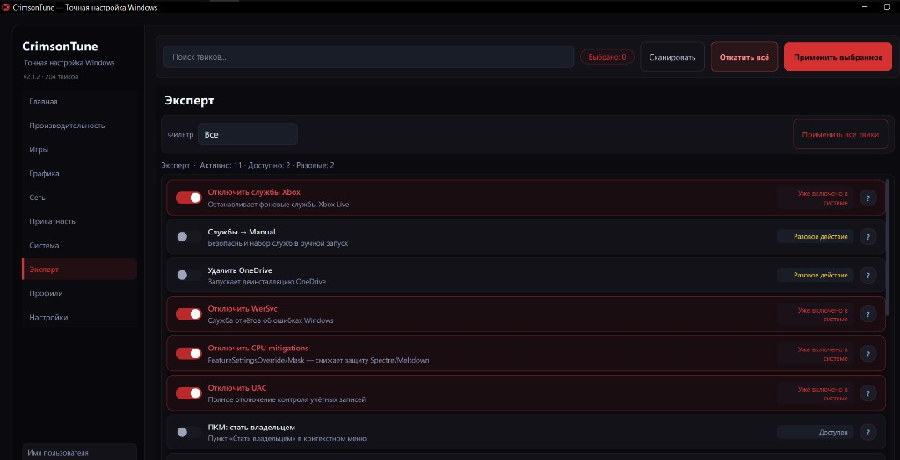
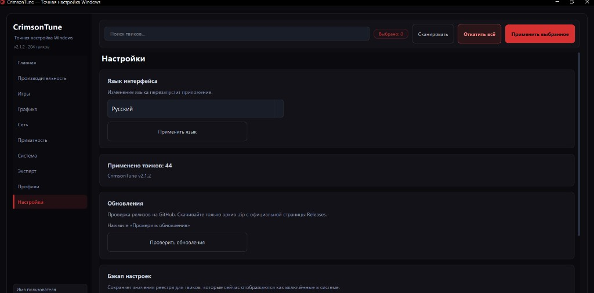

<div align="center">



[](https://github.com/expl01t-search/CrimsonTune/releases/latest)
[](#features)
[](https://github.com/expl01t-search/CrimsonTune)
[](https://github.com/expl01t-search/CrimsonTune/blob/main/requirements.txt)
[](https://github.com/expl01t-search/CrimsonTune/blob/main/LICENSE)

<br>

[](https://github.com/expl01t-search/CrimsonTune/releases/latest/download/CrimsonTune-v2.2.1-win64.zip)
[](README.md)

<br>

<a href="assets/screenshots/dashboard.png">
  
</a>

<sub>321 tweaks · 7 profiles · smart scan · revert · auto-update</sub>

</div>

---

## About

**CrimsonTune** replaces scattered `.reg` files, batch scripts, and long guides with one desktop app. Proven tweaks (WinUtil, Optimize #Expl01t, BoosterX, MSI Mode, SSD Mini Tweaker, and more) with filters, profiles, and full restore.

> ⚠️ Run **as Administrator** — registry, services, and scheduled tasks.

---

## Features

| | |
|:--|:--|
| **321 tweaks** | Performance · SSD · Gaming · Graphics · Network · Privacy · System · Expert |
| **7 profiles** | Balanced · Gamer Pro · Gaming Plus · Max Performance · Privacy · SSD · Ghost Superlite |
| **Smart UI** | State scan · filters · status badges · optimization ring on home |
| **Safety** | Expert tab · `.reg` export · `RESTORE.bat` / `--restore-all` |
| **i18n** | Russian & English — **Settings → Language** |

---

## Quick start

1. Download [**CrimsonTune-v2.2.1-win64.zip**](https://github.com/expl01t-search/CrimsonTune/releases/latest/download/CrimsonTune-v2.2.1-win64.zip)
2. Extract and run **`CrimsonTune.exe` as Administrator**
3. Pick a profile or tweak by category — **Settings → Check for updates**

<details>
<summary><strong>From source / build</strong></summary>

```bash
git clone https://github.com/expl01t-search/CrimsonTune.git
cd CrimsonTune
pip install -r requirements.txt
python main.py
```

Build EXE: `pip install -r requirements-dev.txt` → `python tools/gen_icon.py` → `pyinstaller build.spec`

App data: `%AppData%\CrimsonTune`

</details>

---

## Screenshots

<p align="center">
  <a href="assets/screenshots/performance.png"></a>
  <a href="assets/screenshots/games.png"></a>
</p>
<p align="center">
  <a href="assets/screenshots/expert.png"></a>
  <a href="assets/screenshots/settings.png"></a>
</p>

---

## Changelog

Version history — [**CHANGELOG.md**](CHANGELOG.md) · releases — [**Releases**](https://github.com/expl01t-search/CrimsonTune/releases)

---

<div align="center">


<sub>PySide6 · Python 3.11+ · PyInstaller · by <a href="https://github.com/expl01t-search">Expl01t</a></sub>

</div>
